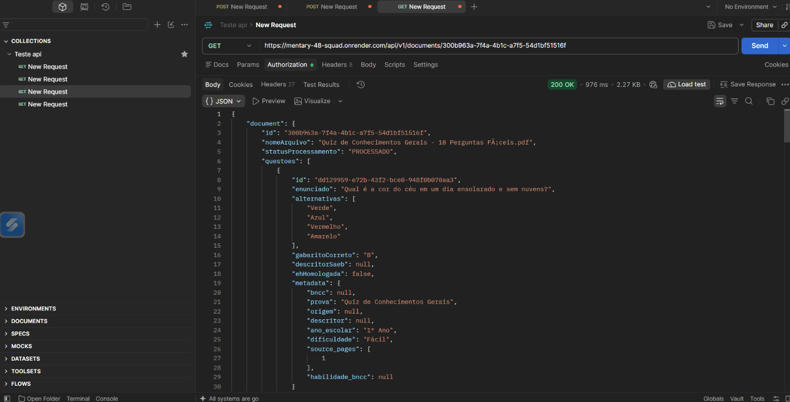

# Modelos de IA e resultados dos testes

Este documento registra os modelos Gemini usados ou considerados no extrator e os resultados observados durante os testes. O histórico será ampliado quando novos testes forem realizados.

## Como o extrator usa o modelo

O backend seleciona o modelo pela variável de ambiente `GEMINI_MODEL`. O valor padrão do projeto é `gemini-3.8-flash`. O extrator envia texto, imagens ou páginas de PDF ao Gemini e solicita questões em JSON estruturado, incluindo enunciado, alternativas, gabarito e metadados pedagógicos.

O formato de resposta é validado pelo código da API. Uma mudança de modelo pode ser feita pela variável `GEMINI_MODEL`, sem mudar o fluxo de upload ou o banco, desde que o modelo aceite as entradas e a saída estruturada usadas pelo extrator. Ainda assim, cada modelo precisa ser testado com arquivos representativos antes de ser considerado adequado.

## Modelos registrados

| Modelo | Situação | Compatibilidade e observações |
| --- | --- | --- |
| `gemini-3.8-flash` | Usado nos testes relatados | Modelo configurado como padrão do projeto. A documentação do Google informa suporte a PDF, imagem e saída estruturada. Houve uma extração bem-sucedida com uma imagem de questão. Também houve resposta `503` de alta demanda em um teste de PDF; isso indica indisponibilidade temporária naquela tentativa, não um teste comparativo de qualidade. |
| `gemini-3.6-flash` | Testado com sucesso | Alternativa da família Flash. A documentação do Google informa suporte a PDF, imagem e saída estruturada. O PDF de avaliação foi processado e a resposta exibida confirmou a extração de uma questão. |

As informações de compatibilidade acima vêm da documentação oficial do Google. Disponibilidade, cotas e comportamento podem depender da chave, do projeto e do momento da chamada.

## Histórico de testes realizados

### Gemini 3.8 Flash — imagem com uma questão de múltipla escolha

- **Entrada:** captura de uma questão legível: “Qual é a capital do Brasil?”, com quatro alternativas.
- **Resultado:** `PROCESSADO`.
- **Extração:** uma questão com as quatro alternativas e gabarito `C` (Brasília).
- **Homologação:** a questão permaneceu como rascunho (`ehHomologada: false`), conforme esperado; não foi aprovada automaticamente.
- **Conclusão:** teste funcional bem-sucedido para extração de uma questão a partir de imagem.

### Gemini 3.8 Flash — PDF de referência

- **Entrada:** `Modelo da questão para compatibilidade (1).pdf`.
- **Resultado:** `PROCESSADO`, com `questoes` vazio.
- **Conclusão:** o processamento terminou, mas esse resultado não comprova extração de questões. O conteúdo do arquivo não foi confirmado como uma questão extraível.

### Gemini 3.8 Flash — PDF de avaliação

- **Entrada:** PDF informado como contendo uma página e dez questões.
- **Resultado:** `ERRO`.
- **Erro nos logs:** Gemini respondeu `503` (`UNAVAILABLE`) informando alta demanda temporária. O extrator fez três tentativas rápidas e então marcou o documento com erro.
- **Conclusão:** teste inconclusivo sobre a capacidade do modelo de extrair as dez questões; a chamada falhou por indisponibilidade temporária, não por um resultado de extração incorreto.

### Gemini 3.6 Flash — PDF de avaliação

- **Entrada:** `Quiz de Conhecimentos Gerais - 10 Perguntas Fáceis.pdf`.
- **Resultado:** `PROCESSADO`.
- **Extração observada:** a resposta retornou questão(ões); a captura confirma pelo menos uma questão com enunciado, alternativas e gabarito.
- **Conclusão:** teste funcional bem-sucedido com esse PDF. A captura compartilhada não permite confirmar a quantidade total de questões extraídas.

Captura da resposta do teste:



## Próximos testes sugeridos

1. Se quiser comparar os modelos, repetir o mesmo PDF com `gemini-3.8-flash` quando estiver disponível e comparar os resultados.
2. Registrar a quantidade total de questões e o gabarito esperado para medir a qualidade da extração, não apenas o estado `PROCESSADO`.
3. Comparar modelos somente com o mesmo arquivo e registrar resultado, latência aproximada e erros. Não incluir chaves, tokens, senhas ou URLs privadas nos registros.

## Modelo para registrar novos testes

Copie e preencha uma seção como esta a cada novo teste:

```text
### <modelo> — <tipo de arquivo e conteúdo>
- Data:
- Arquivo/tipo:
- Resultado: PROCESSADO / ERRO
- Questões esperadas:
- Questões extraídas:
- Gabaritos corretos:
- Tempo aproximado:
- Erros relevantes nos logs (sem credenciais):
- Conclusão:
```

## Referências oficiais

- [Lista de modelos Gemini](https://ai.google.dev/gemini-api/docs/models)
- [Gemini 3.8 Flash](https://ai.google.dev/gemini-api/docs/models/gemini-3.8-flash)
- [Gemini 3.6 Flash](https://ai.google.dev/gemini-api/docs/models/gemini-3.6-flash)
